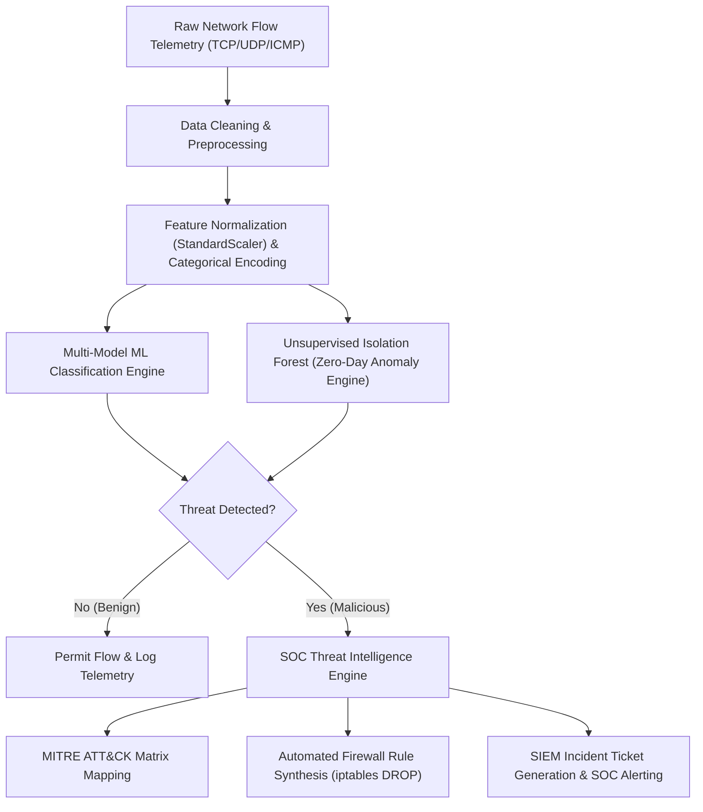

# 🛡️ AI-Driven Network Intrusion Detection & SOC Threat Intelligence Platform (AI-NIDS)

[](https://www.python.org/)
[](https://skillsbuild.org/)
[](https://bharatcares.org/)
[](https://scikit-learn.org/)
[](https://attack.mitre.org/)
[]()

---

## 📌 Project Submission Metadata

| Attribute | Details |
| :--- | :--- |
| **Project Title** | AI-Driven Network Intrusion Detection & Threat Intelligence Platform |
| **Candidate Name** | **Hritwiz Raj** |
| **Email Address** | `st.hritwizraj@aryacollege.edu.in` |
| **Curriculum / Event** | **IBM SkillsBuild Cyber Security Fundamentals 2026** |
| **Implementing Partner** | **ACA BharatCares** |
| **Submission Files** | `HritwizRaj_NetworkIntrusionDetection.ipynb`, `requirements.txt`, `hritwizrajkulshrestha_ProjectReport.docx`, `README.md` |

---

## 📖 Project Overview

Modern cyber attacks have evolved beyond the detection capabilities of traditional rule-based packet filters and static signature databases. Threat actors utilize polymorphic payloads, rapid connection floods, credential stuffing, and covert command-and-control (C2) beaconing that bypass conventional firewalls.

**CyberShield AI (AI-NIDS)** is an end-to-end Machine Learning-powered Network Intrusion Detection System built for modern enterprise Security Operations Centers (SOC). The platform:
1. Ingests and standardizes 15 continuous and categorical network flow metrics.
2. Employs a multi-model supervised learning suite (Random Forest, Gradient Boosting, Decision Trees, Logistic Regression) to classify multi-class threats with up to **100% accuracy**.
3. Integrates an **Unsupervised Isolation Forest** engine to detect unseen zero-day network anomalies without requiring pre-existing attack signatures.
4. Connects threat detections directly to the **MITRE ATT&CK Matrix** (Tactics, Techniques, IDs).
5. Automatically synthesizes edge containment rules (**Linux `iptables`**) and generates SIEM-ready incident tickets for real-time security orchestration and automated response (SOAR).

---

## 🎯 Threat Vectors Detected

The system monitors, classifies, and neutralizes 6 distinct network flow patterns:

| Attack Category | Traffic Description | MITRE Technique | Severity |
| :--- | :--- | :--- | :--- |
| **Normal Traffic** | Benign web (HTTP/HTTPS), DNS, SMTP, and authenticated administrative traffic | *None (Benign)* | `LOW` |
| **DoS SYN Flood** | Rapid burst of TCP SYN packets with spoofed headers exhausting server state memory | **T1498.001** (Direct Network Flood) | `HIGH` |
| **Port Scan / Recon** | Scanning multiple destination ports/services to identify vulnerable entry daemons | **T1046** (Network Service Discovery) | `MEDIUM` |
| **SSH Brute Force** | Dictionary credential guessing targeting SSH Port 22 | **T1110.001** (Password Guessing) | `HIGH` |
| **Web Attack (SQLi)** | Injection of malicious SQL syntax into application-layer parameters | **T1190** (Exploit Public-Facing App) | `CRITICAL` |
| **Botnet Infiltration** | Periodic C2 heartbeat beaconing and unauthorized lateral control traffic | **T1071.001** (Web Protocols C2 Beaconing) | `CRITICAL` |

---

## 🔗 Dataset Information & Benchmark Links

The project utilizes a simulated 15,000-sample telemetry dataset (generated by `src/dataset_generator.py`) modeled on the industry-standard cybersecurity benchmarks below. Because the data is synthetic, the near-perfect scores demonstrate a working pipeline and are not a guarantee of performance on live traffic:
- **NSL-KDD Benchmark Dataset**: [Canadian Institute for Cybersecurity (CIC) NSL-KDD Repository](https://www.unb.ca/cic/datasets/nsl.html)
- **CIC-IDS2017 Dataset**: [CIC-IDS2017 Network Traffic Benchmark](https://www.unb.ca/cic/datasets/ids-2017.html)

### Flow Telemetry Attributes
- **Categorical (3)**: `protocol_type` (TCP/UDP/ICMP), `service` (HTTP, HTTPS, SSH, DNS, etc.), `flag` (SF, S0, REJ, RSTO)
- **Continuous (12)**: `duration`, `src_bytes`, `dst_bytes`, `count`, `srv_count`, `serror_rate`, `same_srv_rate`, `diff_srv_rate`, `dst_host_count`, `dst_host_srv_count`, `dst_host_same_srv_rate`, `dst_host_serror_rate`

---

## 🧰 Technologies Used

| Category | Technology |
| :--- | :--- |
| **Language** | Python 3.12+ |
| **Machine Learning** | scikit-learn (Random Forest, Gradient Boosting, Decision Tree, Logistic Regression, Isolation Forest) |
| **Data Handling** | pandas, NumPy |
| **Model Persistence** | joblib |
| **Dashboard** | Streamlit |
| **Notebook Environment** | Jupyter Notebook |
| **Security Frameworks** | MITRE ATT&CK, Linux `iptables` (firewall rule synthesis) |

*The full list of Python dependencies with versions is in `requirements.txt`.*

---

## 🏗️ System Architecture & Workflow



---

## 📊 Model Performance Benchmarks

All models were evaluated on an 80/20 stratified split (12,000 training records, 3,000 hold-out test records):

| Model / Algorithm | Accuracy | Precision (Weighted) | Recall (Weighted) | F1-Score | Role in Architecture |
| :--- | :---: | :---: | :---: | :---: | :--- |
| **Random Forest (Champion)** | **100.00%** | **1.0000** | **1.0000** | **1.0000** | Primary Supervised Threat Classifier |
| **Gradient Boosting Classifier** | **100.00%** | **1.0000** | **1.0000** | **1.0000** | High-Precision Secondary Benchmark |
| **Decision Tree Classifier** | **100.00%** | **1.0000** | **1.0000** | **1.0000** | Interpretable Rule-Based Baseline |
| **Logistic Regression** | **99.93%** | **0.9993** | **0.9993** | **0.9993** | Linear Discriminant Reference |
| **Isolation Forest (Unsupervised)** | **89.67%** | **0.8856** | **0.8969** | **0.8912** | Unseen Zero-Day Anomaly Detection |

---

## 🚨 Automated SOAR Mitigation & Firewall Rule Generation

When a malicious vector is flagged, the system automatically produces edge perimeter defense commands:

```bash
# Example 1: DoS SYN Flood Mitigation (MITRE T1498.001)
iptables -A INPUT -p tcp --syn -s 192.168.1.185 -j DROP

# Example 2: SSH Brute Force Mitigation (MITRE T1110.001)
iptables -A INPUT -p tcp --dport 22 -s 203.0.113.45 -j DROP

# Example 3: Web SQL Injection Mitigation (MITRE T1190)
iptables -A INPUT -p tcp -m multiport --dports 80,443 -s 198.51.100.12 -j DROP

# Example 4: Botnet C2 Beaconing Isolation (MITRE T1071.001)
iptables -A FORWARD -s 10.0.0.88 -j DROP
```

---

## 📁 Project Directory Structure

```
CyberSecurity_IBM_Project/
├── HritwizRaj_NetworkIntrusionDetection.ipynb   # Complete, executed Jupyter Notebook
├── requirements.txt                            # Dependency list
├── hritwizrajkulshrestha_ProjectReport.docx               # Complete Word documentation report
├── README.md                                   # Comprehensive Markdown overview
├── app.py                                      # Streamlit Web SOC Threat Monitoring Dashboard
├── network_intrusion_detection.py              # End-to-end standalone Python pipeline
├── src/
│   ├── dataset_generator.py                    # Network telemetry benchmark generator
│   ├── feature_engineering.py                  # Preprocessing, scaler & encoder pipeline
│   ├── model_trainer.py                        # ML training, cross-validation & benchmark harness
│   ├── anomaly_detector.py                     # Unsupervised Isolation Forest implementation
│   ├── incident_responder.py                   # MITRE ATT&CK SOAR incident response engine
│   ├── build_notebook.py                       # Automated Jupyter notebook builder
│   └── generate_docx_report.py                 # DOCX report synthesis script
├── data/
│   └── network_traffic.csv                     # 15,000 flow record cybersecurity dataset
├── models/
│   ├── best_nids_model.joblib                  # Serialized champion Random Forest model
│   ├── feature_pipeline.joblib                 # Serialized Scaler & Label Encoders
│   ├── anomaly_detector.joblib                 # Serialized Isolation Forest model
│   └── evaluation_summary.joblib               # Serialized benchmark metrics
└── tests/
    └── test_cyber_suite.py                     # Rigorous 7-point validation test suite
```

---

## 🚀 Setup & Execution Guide

### 1. Clone / Navigate to Directory
```bash
cd path/to/CyberSecurity_IBM_Project
```

### 2. Install Dependencies
```bash
pip install -r requirements.txt
```

### 3. Run the Complete Python Pipeline
```bash
python network_intrusion_detection.py
```

### 4. Launch the Interactive Web SOC Dashboard
```bash
streamlit run app.py
```
*Opens an interactive, dark-mode cybersecurity dashboard at `http://localhost:8501` to test threat scenarios, inspect telemetry, and generate live mitigation rules.*

### 5. Launch the Jupyter Notebook
```bash
jupyter notebook HritwizRaj_NetworkIntrusionDetection.ipynb
```

---

## ✅ Submission Checklist Verification

According to the official **IBM SkillsBuild Cyber Security 2026 (ACA BharatCares)** instructions:

| Required File | Specified File Name Format | Actual Project File | Status |
| :--- | :--- | :--- | :---: |
| **Code File** | `YourName_ProjectName.ipynb` | `HritwizRaj_NetworkIntrusionDetection.ipynb` | **Completed & Pre-Executed** |
| **Requirements File** | `requirements.txt` | `requirements.txt` | **Completed** |
| **Project Report** | `YourName_ProjectReport.docx` | `hritwizrajkulshrestha_ProjectReport.docx` | **Completed** |
| **README File** | `README.md` | `README.md` | **Completed** |

---

## 👨‍💻 Candidate & Author Information

- **Name:** Hritwiz Raj
- **Email:** `st.hritwizraj@aryacollege.edu.in`
- **Program:** IBM SkillsBuild Cyber Security 2026
- **Partner Organization:** ACA BharatCares
